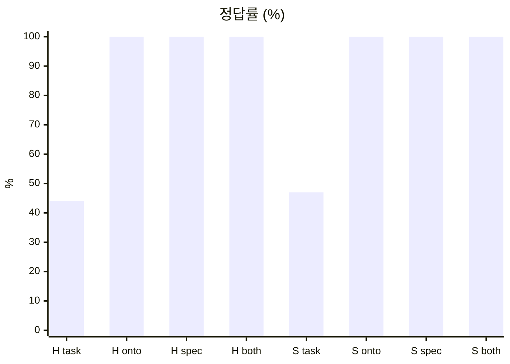
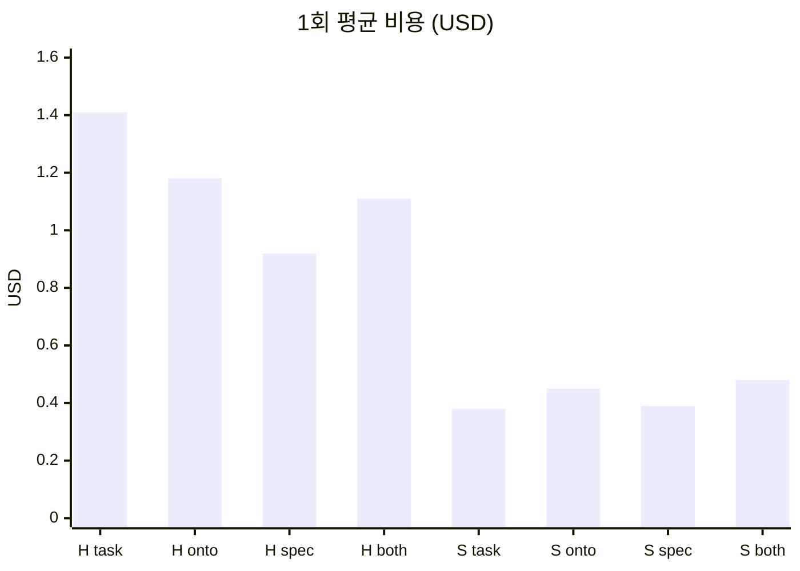
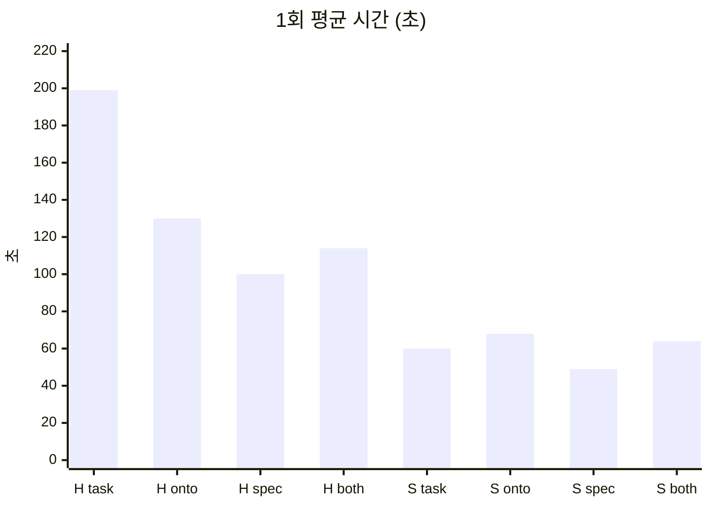

<div align="center">

# 🧪 ontology-coding-bench

**코딩 AI에게 온톨로지를 주면 정말 더 잘 짤까?**

같은 과제를 지식 문서만 바꿔 가며 Claude Code에 시키고, 숨은 테스트로 채점합니다.


</div>

---

## 📌 한눈에 보기

- **질문**: 온톨로지 · PRD · SDD 중 무엇을 주면 정확하고 싸게 코드를 짜는가?
- **과제**: 가상회사 '온톨컴퍼니'의 연차휴가 모듈 `leave.js` 만들기
- **방법**: 조건마다 빈 폴더 → 같은 과제 → 다른 지식 문서 → 숨은 테스트 채점
- **측정**: 정답률 · 비용(USD) · 시간 · 턴 수
- **반복**: 조건마다 3회

---

## 🌱 출발점

- **실제 프로젝트에서 겪은 고민**
  - AI 에이전트에게 온톨로지 · PRD · SDD를 **셋 다** 만들어 줌
  - 같은 사실이 세 문서에 겹침 → 만들고 맞추는 비용이 큼
  - 고민: **"꼭 온톨로지까지 필요할까?"**
- **[단테](https://www.youtube.com/watch?v=bZJa_I8EnUc) 채널 영상에서 알게 된 것**
  - 프로젝트 규모에 따라 에이전트에 줄 지식을 **다르게 설계**해야 함
  - 작은 과제: 스펙 하나면 충분, 더 주면 비용만 늘어남
  - 도메인이 두꺼운 과제: 온톨로지가 정확도를 올림
- **그래서 직접 검증**: 내 도메인 · 내 과제에서도 그런가?

### 영상이 보여 준 숫자

| 실험 | 지식 없이 | 온톨로지 |
|---|---:|---:|
| 2023년 연구 · GPT-4 · 보험 DB | 16% | 54% |
| 영상 · Claude · 보험 DB | 62% | 77~82% |
| 영상 · Claude · 따릉이 코딩 | - | 100% |

- 2023년 연구: GPT-4가 SQL로 바로 답하면 16%, 온톨로지 기반 지식 그래프로 답하면 54%
- 영상: 모델이 좋아져 스키마만으로 62%, 그래도 온톨로지를 주면 **+15~20%p**
- 따릉이 코딩: 지식을 하나라도 넣으면 100%, 온톨로지를 더해도 비용만 늘어남

### 내 실험 결과와 비교

| 실험 | 지식 없이 | 온톨로지 | 스펙 |
|---|---:|---:|---:|
| 연차 코딩 (Haiku · Sonnet) | 44~47% | 100% | 100% |
| 인사 DB 챗봇 (Haiku · Sonnet) | 67% | 97~100% | 97~100% |

- 연차 코딩의 "지식 없이" = 과제 설명만, 챗봇의 "지식 없이" = 스키마만
- **코딩**: 영상과 같음 — 문서만 있으면 모양은 상관없음
- **챗봇**: 영상보다 차이가 큼 — 스키마만 67% → 규칙 문서 97~100% (**+30%p**)
  - 다만 온톨로지와 스펙(업무 규칙 명세)의 차이는 작음
  - 핵심은 "온톨로지라는 형식"보다 **"회사 규칙이 문서에 있느냐"**

### 이 저장소가 재는 것

- 규칙이 정해진 **모듈 개발**에 온톨로지가 필요한가?
- 모델이 **미리 알 수 없는** 회사 규칙 · **경계값 함정**이 많으면?
- 짝 실험: [ontology-sql-bench](https://github.com/kyungchan3007/ontology-sql-bench) (DB 챗봇)

---

## 📊 결과 (2026-10-29, 24회)

> 그래프 축: **H** = Haiku 5.5, **S** = Sonnet 5.5

### 정답률



| 조건 | Haiku 5.5 | Sonnet 5.5 |
|---|---:|---:|
| task-only | 44% | 47% |
| ontology | 100% | 100% |
| spec | 100% | 100% |
| both | 100% | 100% |

### 1회 평균 비용



| 조건 | Haiku 5.5 | Sonnet 5.5 |
|---|---:|---:|
| task-only | $1.41 | $0.38 |
| ontology | $1.18 | $0.45 |
| spec | **$0.92** | **$0.39** |
| both | $1.11 | $0.48 |

### 1회 평균 시간 · 턴



| 조건 | Haiku 5.5 | Sonnet 5.5 |
|---|---:|---:|
| task-only | 199s · 6.0 | 60s · 6.0 |
| ontology | 130s · 6.7 | 68s · 6.3 |
| spec | **100s** · 7.3 | **49s** · 6.7 |
| both | 114s · 10.7 | 64s · 8.0 |

### 정리

- **지식을 하나라도 주면 100%**, 안 주면 절반도 못 맞힘
- **spec(PRD+SDD)이 가장 싸고 빠름** — 두 모델 모두
- **both는 spec보다 비쌈** — Haiku +21%, Sonnet +24%
  - 턴도 늘어남 (Haiku 7.3 → 10.7)
- **ontology는 spec보다 비쌈** — Haiku +29%, Sonnet +17%
  - 원 영상(거의 같음)과 다른 점
- **Haiku가 Sonnet보다 2.4~3.7배 비쌈**
  - 출력 토큰이 약 3.7배 (31k vs 8.5k)
  - 더 오래 짜고 더 많이 확인함
- 원 영상과 같은 방향: **작은 과제에서는 스펙 하나면 충분**
- 총비용: $18.97

### task-only가 틀린 곳 (6회 중)

| 틀린 횟수 | 테스트 |
|---:|---|
| 6/6 | 근속 1년 → 14일 |
| 6/6 | 1주년 다음 달 1일에 14일 |
| 6/6 | 월 발생 11일 상한 |
| 6/6 | 연간 상한 25일 |
| 6/6 | 출근율 80% 미만 처리 |
| 6/6 | 전년 잔여 이월 없음 |
| 6/6 | 수당 0.5일 내림 |
| 1/6 | 근속 2년 → 15일 |

- 모델은 **근로기준법(기본 15일)** 을 기본값으로 짐작
  - 그래서 "근속 2년 → 15일"은 대부분 우연히 맞음
- 회사만 아는 규칙(1주년 다음 달, 수당 내림, 이월 없음)은 전부 틀림
- 원본 결과: [`results/2026-10-29-run1.md`](results/2026-10-29-run1.md)

---

## ⚙️ 2차: effort 비교 (2026-11-01, 18회)

> 조건 `spec` 고정, `--effort`만 바꿈. 근거: [Claude Code 비용 문서](https://code.claude.com/docs/en/costs)

| 모델 | effort | 정답률 | 비용 | 시간 | 생각 토큰 |
|---|---|---:|---:|---:|---:|
| Haiku | low | 100% | **$0.58** | **55s** | 8.9k |
| Haiku | medium | 100% | $0.91 | 90s | 15.7k |
| Haiku | high | 100% | $0.91 | 101s | 18.5k |
| Sonnet | low | 100% | **$0.27** | **29s** | 1.1k |
| Sonnet | medium | 100% | $0.28 | 31s | 1.3k |
| Sonnet | high | 100% | $0.41 | 57s | 3.7k |

- **low로 내려도 18회 전부 38/38**
- **비용 high 대비**: Haiku −37%, Sonnet −34%
- **시간**: 약 절반
- **Haiku 비용의 정체 = 생각 토큰** (출력의 약 75%)
- 1차 기본값(미지정)은 high와 거의 같음
- **한계**: 쉬운 과제라 정확도가 떨어지는 지점은 못 봄
- 원본: [`results/2026-11-01-run2-effort.md`](results/2026-11-01-run2-effort.md)

---

## 🧑‍🤝‍🧑 3차: 계획 · 생성 · 평가 역할 분리 (2026-11-01, 18회)

> 원본 규정 `source.md`만 제공. 근거: [Harness design for long-running apps](https://www.anthropic.com/engineering/harness-design-long-running-apps)

| 방식 | 흐름 |
|---|---|
| solo | 구현 |
| plan-gen | 계획(PLAN.md) → 구현 (PLAN.md만 봄) |
| gen-eval | 구현 → 검수(REVIEW.md) → 수정 |

| 모델 | 방식 | 정답률 | 비용 | 시간 | 턴 |
|---|---|---:|---:|---:|---:|
| Haiku | solo | 100% | **$1.19** | **134s** | 7.0 |
| Haiku | plan-gen | 100% | $2.90 | 355s | 18.7 |
| Haiku | gen-eval | 100% | $3.96 | 475s | 23.3 |
| Sonnet | solo | 100% | **$0.43** | **57s** | 6.0 |
| Sonnet | plan-gen | 100% | $1.58 | 265s | 14.3 |
| Sonnet | gen-eval | 100% | $1.99 | 323s | 21.7 |

- **원본 규정만 줘도 solo가 이미 100%**
  - 사람이 쓴 spec과 비교: Haiku $0.92 vs $1.19, Sonnet $0.39 vs $0.43
  - 정리된 문서는 정확도가 아니라 **비용을 조금** 줄임
- **역할 분리는 비용만 늘어남**
  - plan-gen: solo의 2.4~3.7배
  - gen-eval: solo의 3.3~4.6배
- 원 글의 교훈과 같은 방향
  - 검수 담당은 **혼자 못 푸는 과제**에서만 값을 함
- **하네스 한계** ([#13](https://github.com/kyungchan3007/ontology-coding-bench/issues/13))
  - 검수 담당 6명 중 3명이 테스트를 실행하지 못함
  - 원인: `node a && node b` 같은 복합 명령이 권한에서 거부됨
  - 이 3명은 코드를 눈으로만 대조함
  - 구현이 이미 100%라 정답률 결론은 그대로
- 원본: [`results/2026-11-01-run3-roles.md`](results/2026-11-01-run3-roles.md)

---

## 🧾 지금까지의 결론 (이 과제 기준)

- 지식 문서는 **필수** — 없으면 절반도 못 맞힘
- 문서 모양(온톨로지 · spec · 원본)은 정확도에 차이 없음
- 가성비 1위: **Sonnet + spec + effort low** ($0.27, 29s)
- 작은 과제에 역할 분리 · 높은 effort는 **낭비**
- 다음 확인할 것: 정확도가 100% 밑으로 떨어지는 **어려운 과제**

---

## 🛠️ 현업에서 겪은 것: 문서만 두면 생기는 일

> 벤치 결과가 아니라 실제 프로젝트의 작업 기록을 돌아본 사례입니다. 원인은 기록을 보고 해석한 것입니다.

**상황**: 중간 규모 프로젝트에서 PRD를 빼고 SDD · 엔티티 · 온톨로지로 운영

| 겪은 일 | 빠져 있던 것 |
|---|---|
| SDD가 PRD 내용으로 채워짐 | 요구사항을 둘 자리 |
| 설계가 사후 기록으로 남음 | SDD의 설계 칸 |
| 디자이너가 온톨로지를 거의 안 읽음 | 읽으라는 지시 |
| 디자이너가 범위 문구를 직접 씀 | 정확한 작업 범위 |
| 원본 수정 금지인데 기록을 추가함 | 충돌 없는 지시 |

- **SDD**
  - PRD를 없애면서 그 내용이 갈 곳을 정하지 않음
  - 설계 칸이 없어 구현 판단이 승인 없이 진행됨
- **온톨로지**
  - 디자이너 27회 중 온톨로지를 직접 찾아본 실행은 1회
  - 에이전트 정의와 위임 프롬프트에 온톨로지를 읽으라는 말이 없었음
  - 위임 프롬프트에 R · P 규칙 번호가 들어간 실행도 0회
  - 먼저 읽으라고 명시한 Figma 지도는 만든 뒤 20회 모두 읽음
- **작업 범위**
  - "패널 정리"라는 지시에 디자이너가 "이번엔 없음"이라는 범위 문구를 씀
- **지시 충돌**
  - 정의: Figma를 바꾸면 변경 기록에 남기기
  - 위임: 원본을 바로 고치지 않기

**배운 것**

- 문서를 만들어 두는 것만으로는 에이전트가 따르지 않음
- 개발자가 **누가, 언제, 무엇을 읽고, 어디까지 할지** 명시해야 함
- 요구사항이 정확하지 않으면 에이전트가 빈칸을 스스로 채움
- 문서를 없앨 때는 그 문서가 하던 일을 누가 받을지 함께 정해야 함

**한계**

- 한 프로젝트의 사례이고 통제 실험이 아님
- 27회에는 에셋 내보내기처럼 온톨로지가 필요 없는 작업도 포함됨
- Figma 지도는 위임 프롬프트에서 함께 언급한 경우도 있어 정의 파일만의 효과로 볼 수 없음
- 온톨로지를 읽지 않아 실제 규칙 위반이 났는지는 확인하지 못함

---

## 🏢 도메인: 온톨컴퍼니 연차휴가

> 가상회사 규정이라 근로기준법과 다릅니다. 모델이 "상식"으로 맞히지 못하게 일부러 비틀었습니다.

| 규칙 | 내용 |
|---|---|
| 1년 미만 | 개근한 달마다 1일 (최대 11일) |
| 첫 연간 연차 | 1주년 달의 다음 달 1일에 14일 |
| 이후 | 매년 1월 1일, 14일 + 근속 1년당 1일 |
| 상한 | 25일 |
| 출근율 80% 미만 | 개근월 수만큼만 |
| 출근 간주 | 육아휴직 · 산재 휴업 · 예비군 |
| 사용 단위 | 1일 · 반차 · 반반차 |
| 미사용 연차 | 소멸 없이 수당 지급 |
| 1일 통상임금 | 연봉 ÷ 12 ÷ 209 × 8 |
| 수당 일수 | 0.5일 단위 내림 |

- 전체 규정: [`knowledge/source.md`](knowledge/source.md)
- 원본에서 정하지 않은 것 3개 → 각 문서에 **미정**으로 표시
- 숨은 테스트는 미정 항목을 건드리지 않음
- R7(사용 순서)은 결과에 영향이 없어 테스트하지 않음

---

## 🪤 숨은 테스트가 노리는 함정

- 1주년 **당일**에는 14일이 아직 없음 → 다음 달 1일에 생김
- 1월 1일 입사자는 첫 기준일에 **15일** (근속 2년)
- 12월 입사자는 1월 1일에 14일 **한 번만** (28일 아님)
- 결근 52일은 정상, **53일**부터 출근율 80% 미만
- 육아휴직 달은 **개근월**로 셈
- 작년 남은 연차로 올해 신청 **불가** (연말에 수당으로 정산)
- 잔여 8.75일 → 수당은 **8.5일분**

---

## 🧫 실험 조건

> 모든 조건에 [`task/TASK.md`](task/TASK.md)는 똑같이 들어갑니다. 바뀌는 건 지식 문서뿐입니다.

| 조건 | 넣는 지식 문서 |
|---|---|
| `task-only` | 없음 |
| `ontology` | ontology.md |
| `spec` | prd.md + sdd.md |
| `both` | ontology + prd + sdd |

| 모델 | ID |
|---|---|
| haiku | claude-haiku-5-5 |
| sonnet | claude-sonnet-5-5 |

- 조건 4개 × 모델 2개 × 3회 = **24회**
- 조건 정의: [`bench/conditions.mjs`](bench/conditions.mjs)
- 다음에 더할 후보
  - `drift`: 한 문서만 옛날 값
  - `json`: 값은 JSON 한 곳에만

### 공정하게 만든 장치

- 작업 폴더는 **저장소 밖** 임시 폴더 → `hidden/` 접근 불가
- 모든 조건에 같은 프롬프트 · 같은 `TASK.md`
- 사용자 설정 · MCP 끔 (`--setting-sources project`, `--strict-mcp-config`)
- 허용 도구: 파일 읽기/쓰기 + `node` 실행만

---

## 📂 폴더 구조

```
ontology-coding-bench/
├── knowledge/              # 지식 문서 (조건별로 골라 넣음)
│   ├── source.md           # 원본 규정 = 정답 기준
│   ├── ontology.md         # 개념 · 속성 · 관계 · 규칙
│   ├── prd.md              # 기능 요구사항 FR-1~10
│   ├── sdd.md              # Key Entities · 설계 · 검증 항목
│   └── leave-policy.json   # 기계가 읽는 값
├── task/
│   └── TASK.md             # 모든 조건 공통 과제 (함수 · 입출력만)
├── bench/
│   ├── conditions.mjs      # 조건 · 모델 · 프롬프트
│   ├── run.mjs             # 실행 + 채점
│   └── report.mjs          # 결과표
├── runs/                   # 실행 원본 (git 제외)
├── results/                # 실행별 결과표 · 원자료
└── hidden/                 # ⚠️ AI에게 절대 보여 주지 않음
    ├── reference/leave.js  # 정답 구현
    └── tests/              # 숨은 테스트 38개
```

---

## 📄 지식 문서 비교

| 문서 | 형태 | 줄 수 |
|---|---|---|
| source.md | 회사 규정 원문 | 95 |
| ontology.md | 개념 · 관계 · 규칙 | 125 |
| prd.md | 요구사항 FR | 53 |
| sdd.md | 엔티티 · 함수 설계 | 102 |
| leave-policy.json | 값 · 공식 | 61 |

- 모두 `source.md` **하나만** 근거로 작성
- 담긴 사실은 같고 **모양만** 다름 → 공정한 비교

---

## 🧩 과제 API

| 함수 | 돌려주는 것 |
|---|---|
| `getGrants(emp, asOf)` | 발생 내역 목록 |
| `getBalance(emp, usages, asOf)` | 잔여 일수 |
| `requestLeave(emp, usages, req)` | 승인 여부 |
| `yearEndPayout(emp, usages, year)` | 연말 수당 |

- 입력 형식: [`task/TASK.md`](task/TASK.md)

---

## ▶️ 실행

- 정답 구현으로 테스트 검증

```bash
npm run test:reference
```

- AI가 만든 `leave.js` 채점

```bash
LEAVE_MODULE=path/to/leave.js npm run test:reference
```

- 전체 실험 (24회)

```bash
npm run bench
```

- 일부만 (예: Haiku · spec · 1회)

```bash
node bench/run.mjs --models haiku --conditions spec --reps 1
```

- 결과표 (가장 최근 실행)

```bash
npm run report
```

- 2차 · 3차 재현

```bash
node bench/run.mjs --conditions spec --efforts low,medium,high --concurrency 2
node bench/run.mjs --conditions source-only --modes solo,plan-gen,gen-eval --concurrency 2
```

| 옵션 | 기본값 |
|---|---|
| `--models` | haiku,sonnet |
| `--conditions` | task-only,ontology,spec,both |
| `--efforts` | default (모델 기본값) |
| `--modes` | solo |
| `--reps` | 3 |
| `--concurrency` | 1 |

- 필요: Node 22, 로그인된 `claude` CLI
- 전체 24회 소요: 약 20분 (동시 2), $18.97

---

## 🚧 진행 상황

- [x] 원본 규정 `source.md`
- [x] 공통 과제 `TASK.md`
- [x] 정답 구현 + 숨은 테스트 38개
- [x] 지식 문서 4종
- [x] 실행 · 채점 · 결과표 스크립트
- [x] 전체 24회 실행
- [x] 결과표
- [x] 그래프
- [x] 채점 개선: 규칙별 · pass^3 · 실행 기록
- [x] 2차: effort 비교
- [x] 3차: 역할 분리
- [ ] drift · json 조건 ([#1](https://github.com/kyungchan3007/ontology-coding-bench/issues/1), [#2](https://github.com/kyungchan3007/ontology-coding-bench/issues/2))

---

## 🙏 출처

- 영상: [단테 — 온톨로지 실험](https://www.youtube.com/watch?v=bZJa_I8EnUc)
  - 따릉이 요금 코딩 실험 · 보험 DB 챗봇 실험
  - 이 저장소는 그중 **코딩 실험**을 다른 도메인으로 다시 재 본 것

## 🔗 관련

- 챗봇 실험: [ontology-sql-bench](https://github.com/kyungchan3007/ontology-sql-bench)
